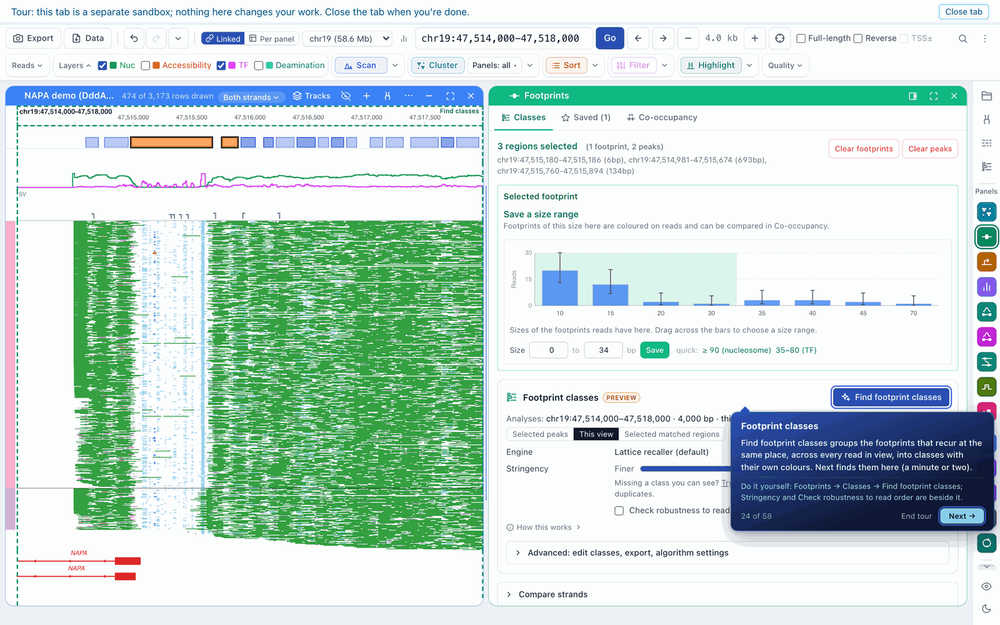
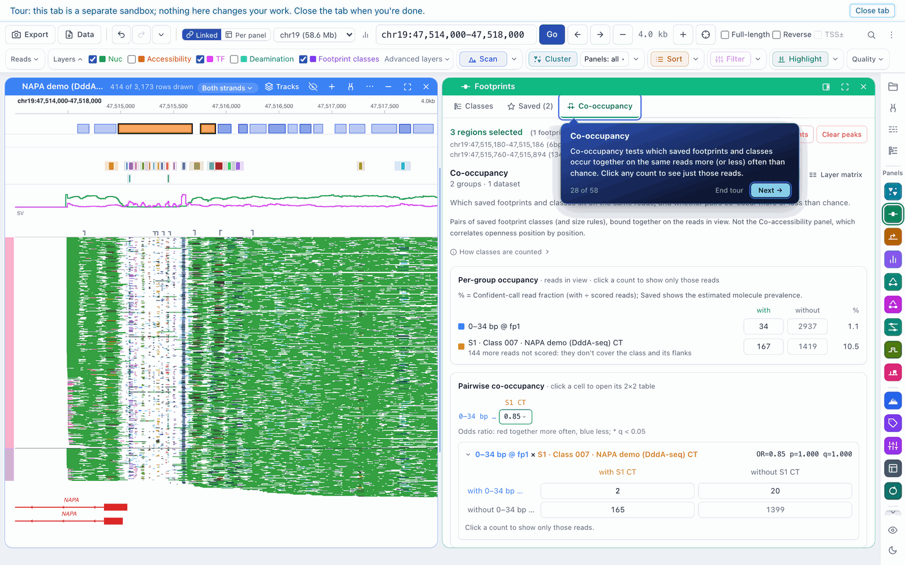
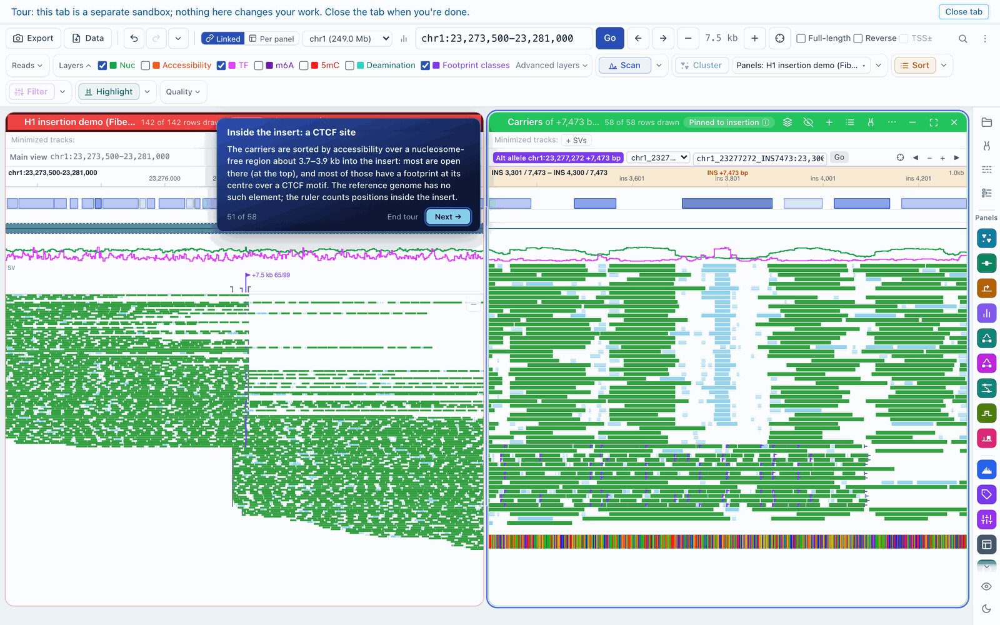
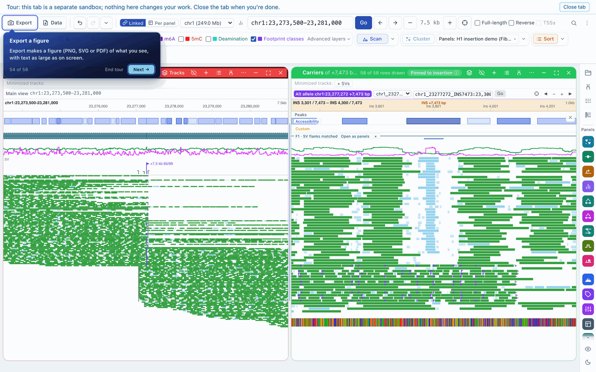

# A tour of FiberBrowser's features

## Clustering and comparing datasets

Clustering works on the molecules themselves: each molecule gets a cluster from its footprints at the selected peaks, and loading several datasets clusters them together so the same states apply across conditions. The Clusters panel then reports each dataset's share of each cluster, with 95% confidence intervals and pairwise tests. The [preprint](https://www.biorxiv.org/content/10.64898/2026.10.29.762797v1) shows this for lymphoblastoid and embryonic stem cell Fiber-seq at NANOG.

## Footprint classes and co-occupancy

**Find footprint classes** looks at every molecule in view for footprints that recur at the same place, groups them into classes, and estimates how often each molecule carries each one. Saved classes keep their prevalence per strand, and **Co-occupancy** tests whether saved footprints and classes occur together on the same molecules more or less often than chance.

## Haplotypes, variants and insertions

Molecules can be split by haplotype (HP tags), by the base they carry at a variant, or by whether they carry a structural variant. Each group gets its own panel, and clustering and statistics run across them.

The [preprint](https://www.biorxiv.org/content/10.64898/2026.10.29.762797v1) uses this to show parent-of-origin chromatin at the imprinted SNRPN locus and allele-specific NRF1 binding at a heterozygous variant.

Standard browsers mark or clip a read's inserted sequence and hide its chromatin. FiberBrowser builds the inserted allele from the carrier molecules and draws their calls across it, so the chromatin inside a non-reference insertion can be clustered, sorted and analysed like any other region. In the example below, a 7.5-kb insertion in H1 carries a CTCF site that is footprinted on most carrier molecules.

## Export and scripting

**Export** makes a figure (PNG, SVG or PDF) of what you see, and **Data** exports the per-read calls, cluster assignments and panel tables behind it. Exported figures carry a small citation line, which you can turn off.

FiberBrowser also runs headless: a Python client and Jupyter integration load regions, run clustering and pull results from a notebook through the same engine. See the [API guide](https://github.com/fiberseq/FiberBrowser/blob/main/docs/browser_api_guide.md).

The [user guide](https://github.com/fiberseq/FiberBrowser/blob/main/docs/guide.md) covers everything else, including track hubs, primer design for targeted DAF-seq, quality filters and the local Copilot.
