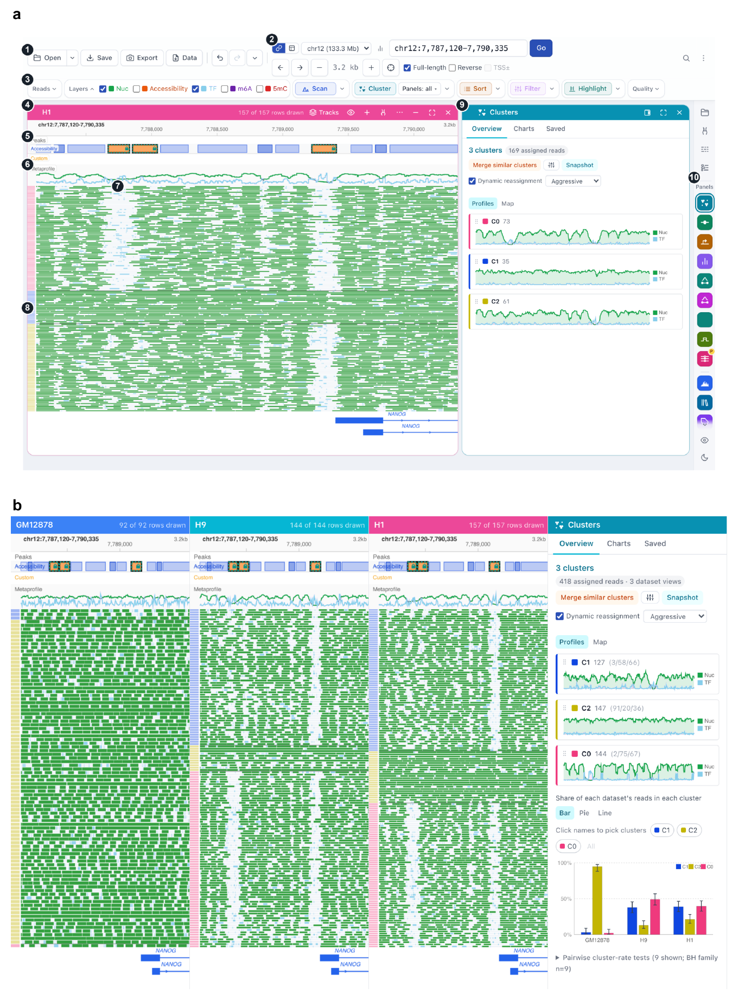

# FiberBrowser: a genome browser for single molecules

FiberBrowser is an interactive genome browser for single-molecule chromatin data: Fiber-seq (m6A, PacBio or Oxford Nanopore) and DAF-seq (deamination, DddB or SsDddA). Most browsers summarise reads into coverage tracks. FiberBrowser draws every molecule as its own row, with its nucleosomes, transcription-factor and other small footprints, accessible DNA and base modifications, and lets you analyse those molecules as a population: cluster them, compare datasets, split them by haplotype or allele, and export figures and the numbers behind them.

The footprints come from [FiberHMM](../fiberhmm/fiberhmm.md), which FiberBrowser installs and runs. FiberHMM writes its calls into the BAM as Molecular-annotation tags, so the same calls feed FiberBrowser, FIRE and your own scripts.

*From the [FiberBrowser preprint](https://www.biorxiv.org/content/10.64898/2026.10.29.762797v1) (Fig. 3). **a**, The interface with one H1 Fiber-seq dataset at NANOG: (1) file and session controls, (2) locus and panel navigation, (3) the toolbar of molecule operations (layers, scanning, clustering, sorting and filtering), (4) the dataset panel header, (5) peak and custom-feature tracks, (6) the nucleosome (green) and footprint (sky blue) metaprofile, (7) molecule rows drawn from their FiberHMM calls, (8) the cluster-membership strip, (9) the analysis sidebar, here the Clusters panel, and (10) the rail that opens analysis panels. **b**, Joint clustering of lymphoblastoid (GM12878) and embryonic stem cell (H9, H1) Fiber-seq on accessibility at the NANOG promoter and a nearby enhancer, with the per-dataset share of each cluster.*

## What you can do with it

- **See every molecule.** Each read is drawn with its calls, at thousands of reads per locus.
- **Turn a locus into a population analysis.** Cluster molecules by their footprints at chosen peaks, compare cluster proportions across datasets with confidence intervals, and sort or filter by any footprint.
- **Find recurrent footprints.** Footprint classes groups footprints that recur at the same place across molecules and measures how often each molecule carries them; co-occupancy tests which footprints occur together on the same molecules.
- **Compare alleles on single fibers.** Split molecules by haplotype, by a variant's base, or by carriage of a structural variant, and expand an insertion to see the chromatin inside it.
- **Export.** Figures as PNG, SVG or PDF, and the per-read data behind every panel.
- **Script it.** A Python API and Jupyter integration drive the same engine.

## In this chapter

- [Getting started](getting-started.md): install, open your data, and read the view.
- [A tour of the features](features.md): clustering, footprint classes, haplotypes and variants, export.

The source code and full documentation are on [GitHub](https://github.com/fiberseq/FiberBrowser); the [user guide](https://github.com/fiberseq/FiberBrowser/blob/main/docs/guide.md) covers every feature.

## Cite

FiberBrowser and FiberHMM are described in:

> Tullius, T. W., Catalano, C., Ranchalis, J., Hu, J., Vollger, M. R., Stergachis, A. B., & Levine, M. S. (2026). FiberBrowser: a unified framework for single-molecule genomics. *bioRxiv*. [https://doi.org/10.64898/2026.10.29.762797](https://doi.org/10.64898/2026.10.29.762797)
