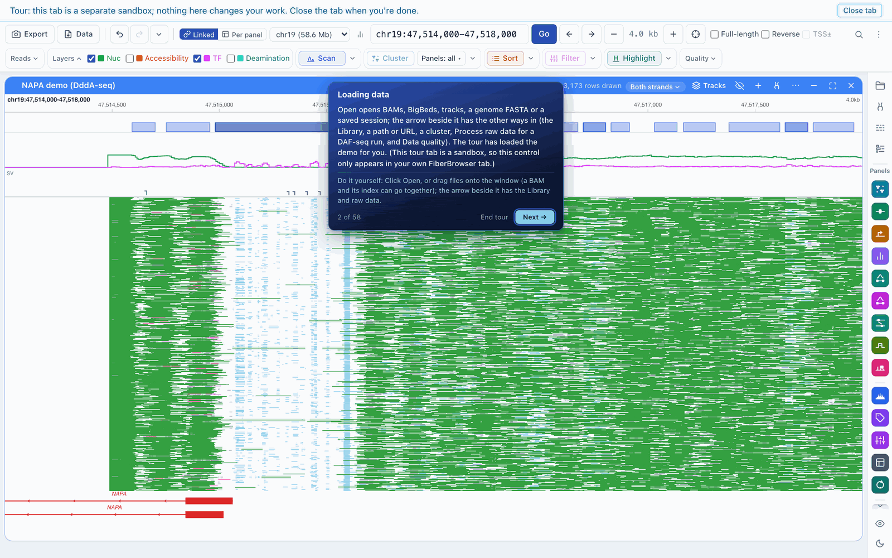
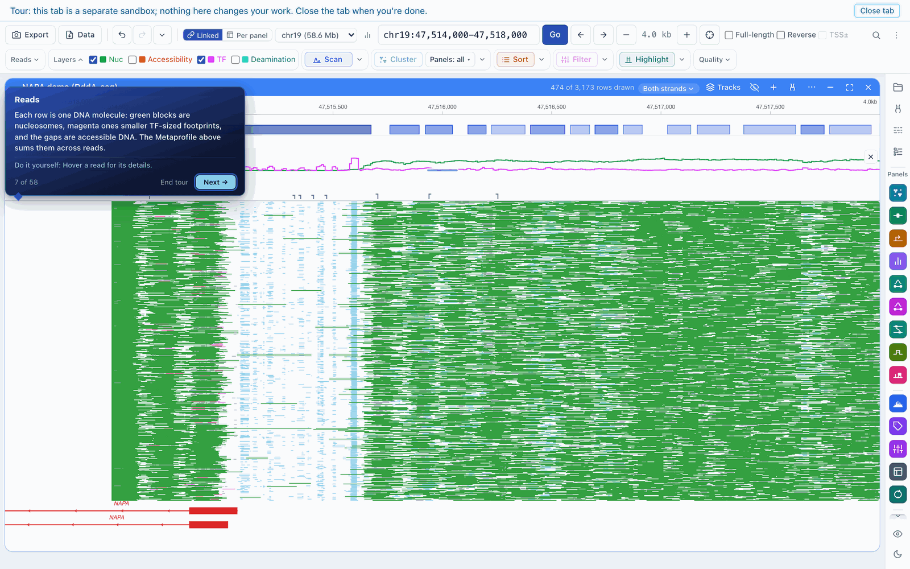
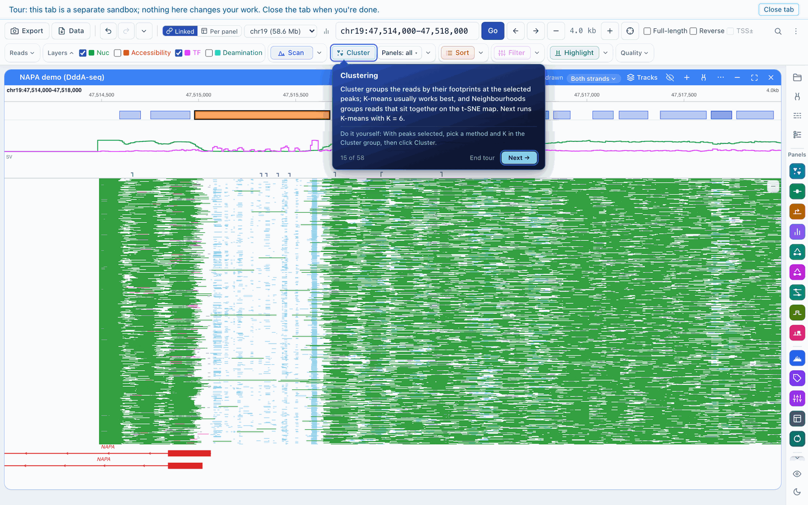

# Getting started with FiberBrowser

## Install

| You want | Do this |
|---|---|
| The Mac app (Apple silicon) | Download the `.dmg` from [Releases](https://github.com/fiberseq/FiberBrowser/releases) and drag FiberBrowser to Applications. It bundles Python, FiberHMM, minimap2 and BLAST+. |
| The Windows app | Run the `Setup.exe` from [Releases](https://github.com/fiberseq/FiberBrowser/releases). It runs in WSL 2 and opens in its own window. |
| The `fiberbrowser` command (macOS, Linux or WSL; Python 3.10+) | `pipx install "fiberbrowser[app]"`, then run `fiberbrowser`. This also installs FiberHMM from PyPI. |

[Installing FiberBrowser](https://github.com/fiberseq/FiberBrowser/blob/main/docs/install.md) covers conda, servers and Docker.

## Take the tour first

The welcome screen's **Take the tour** opens a demo dataset in its own tab and walks through the main features step by step. Nothing in the tour tab changes your own work. The screenshots on these pages come from it.

## Open your data

**Open**, at the top left, opens:

- Fiber-seq or DAF-seq BAMs (aligned, sorted and indexed), ideally with FiberHMM calls;
- a genome FASTA, gene annotations (GTF or GFF3), BigWig, BigBed and BED tracks;
- plasmid maps and saved sessions.

You can also drag files onto the window. If your BAM has no footprint calls yet, FiberBrowser shows the raw modifications, and its DAF-seq run wizard or [FiberHMM](../fiberhmm/usage.md) can call them.

## Read the view

Type a gene name or coordinates in the locus box and press **Go**; drag to pan and use **+**/**−** to zoom. Each row is one DNA molecule:

- the long green blocks are nucleosomes;
- the short blocks in a second colour are transcription-factor-sized and other small footprints;
- the DNA between them is accessible.

**Layers** turns each kind of call on or off, and for DAF-seq shows the individual deamination marks.

## First analysis: cluster the molecules

1. Click **Scan** to call accessibility peaks in view, then click peaks to select them.
2. Click **Cluster**. Molecules are grouped by their footprints at the selected peaks; K-means usually works best.
3. The coloured strip beside the reads shows each molecule's cluster, and the **Clusters** panel lists the clusters with their sizes and average profiles. Merge, hide or subcluster from there.

Load several datasets and cluster them together to compare conditions, cell types or haplotypes on the same cluster definitions. [A tour of the features](features.md) continues from here.
